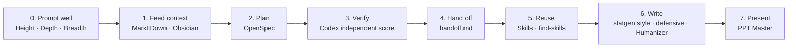

# AI Research Toolkit: Skills, Tools & Prompting Tips for StatGen

*Lab meeting, Nov 9, 2026*

This page continues [Claude_Code_User_Tips.md](Claude_Code_User_Tips.md). That page covers terminal setup, the Codex plugin, Humanize, SLURM Monitor, and Remote Control. This page covers **how to work with AI across a research project**, from feeding it papers to shipping a figure-ready manuscript and slide deck.

The sections follow the order of a real project. Read top to bottom the first time; after that, use the [cheat sheet](#cheat-sheet).



---

## Overview

| # | Part | Tool / Tip | One-line pitch |
|---|------|-----------|----------------|
| 0 | [How to talk to AI](#0-how-to-talk-to-ai-height-depth-breadth) | Height / Depth / Breadth | Stop saying "you are an expert in X". Give it a goal, a workflow, and an outcome |
| 1a | [Feed context](#1a-markitdown-any-file-to-markdown) | MarkItDown | PDF / Word / PPT / Excel → Markdown. Fewer tokens, better answers |
| 1b | [Feed context](#1b-obsidian-a-knowledge-base-your-ai-can-read) | Obsidian | Your notes as plain Markdown that Claude can read, search, and maintain |
| 2 | [Plan](#2-openspec-spec-driven-development) | OpenSpec | Agree on a written spec before AI writes code |
| 3 | [Verify](#3-codex-review-independent-scoring) | Codex independent scoring | A second model scores the work against a rubric |
| 4 | [Continuity](#4-handoffmd-never-lose-context) | `handoff.md` | One file that lets a new session pick up where the last one stopped |
| 5a | [Reuse](#5a-make-it-a-skill) | Make it a skill | Turn a good session into a `/command` |
| 5b | [Reuse](#5b-find-skills--top-skills) | find-skills, top skills | Use skills other people already wrote |
| 6 | [Writing](#6-writing) | statgen-writing-style · defensive writing · Humanizer · ref verification | Write in lab style, stop GPT from watering down claims, sound human, cite real papers |
| 7 | [Present](#7-ppt-master-documents-to-editable-pptx) | PPT Master | Paper → **editable** PowerPoint |
| 8 | [StatGen tips](#8-practical-tips-for-statgen-research) | HPC, big files, simulation checks, DUAs | Lessons from using AI on real genetics projects |

---

## 0. How to Talk to AI: Height, Depth, Breadth

### The idea

Felix Rieseberg (Anthropic, Claude Code desktop and Cowork) argues that most people under-use AI. The bottleneck is how much we ask for, not what the model can do. **Role-play prompts ("You are a world-class geneticist…") rarely help.** Push the prompt along three directions instead:

| Direction | Instead of… | Do this |
|-----------|-------------|---------|
| **Height**: raise the goal | Describing the *task* ("fix this one crash") | Describe the *result* you want ("make the app stop crashing"). Give it the materials and let it reproduce, fix, and verify on its own |
| **Depth**: real expert workflow | "Act as an expert" | Ask: *"What data, tools, and methods would the best person in this field use? Use them to do this task."* The model then follows the expert's actual workflow, not just the expert's tone |
| **Breadth**: verbs, not nouns | Naming an artifact ("write a script") | Describe the effect you want ("make it so we can rerun every figure from raw data with one command"). This leaves room for solutions from other fields |

A fourth rule that goes with these: **verify externally**. Don't let the model grade itself. Run the code, check results on held-out or simulated data, or have a different model review it (see [Part 3](#3-codex-review-independent-scoring)).

### StatGen examples

**Height**

```diff
- Fix the bug in susie_wrapper.R line 120.
+ Our fine-mapping pipeline sometimes returns empty credible sets on chr6 (MHC).
+ Goal: the pipeline gives sensible credible sets on every LD block, or fails loudly with a clear reason.
+ Here are the logs, the input for one failing block, and the LD matrix.
+ Reproduce the failure, find the root cause, fix it, and add a regression test.
```

**Depth**

```diff
- You are an expert in colocalization. Check my coloc results.
+ Before doing anything, list what a top statistical geneticist would check when validating
+ colocalization results: LD mismatch between GWAS and eQTL panels, allele flips, sample overlap,
+ prior sensitivity, multiple causal variants, etc., and the tools they would use for each.
+ Then run those checks on results/coloc_*.tsv and report which ones pass or fail.
```

**Breadth**

```diff
- Write a plotting script for the QQ plot.
+ I want reviewers to trust that our test is calibrated under the null.
+ Propose the evidence that would convince them (QQ plots, genomic inflation, type-I error tables
+ across MAF bins, permutation...), then produce it.
```

### References

- Coverage of Felix's essay (Chinese): <https://www.woshipm.com/ai/6479197.html>
- English summary: <https://fourweekmba.com/ai-a-claude-builders-4-types-of-ambition-for-working-with-ai/>

---

## 1a. MarkItDown: Any File to Markdown

### What it is

[MarkItDown](https://github.com/microsoft/markitdown) (Microsoft) converts PDF, Word, PowerPoint, Excel, HTML, images (OCR), audio, and more into **clean Markdown**.

### Why it matters

- **Saves tokens.** Markdown is the format LLMs handle best. A PDF read through the vision path, or a `.docx` full of XML, costs many more tokens than the same text as Markdown.
- **Better answers.** Headings, tables, and lists survive conversion, so the model sees the paper's structure.
- **Convert once, reuse many times.** The `.md` file can go into Obsidian, a project folder, or any AI tool.

### Install

```bash
pip install 'markitdown[all]'          # everything
pip install 'markitdown[pdf,docx,pptx]' # or only what you need
```

### How to use

```bash
# One file
markitdown paper.pdf -o paper.md

# A folder of papers
mkdir -p papers_md
for f in papers/*.pdf; do markitdown "$f" -o "papers_md/$(basename "${f%.pdf}").md"; done

# Reviewer comments in Word, a collaborator's slides
markitdown reviews_round1.docx -o reviews_round1.md
markitdown lab_meeting.pptx    -o lab_meeting.md
```

Then in Claude Code:

```
Read papers_md/susie_2020.md and papers_md/colocboost_2025.md.
Make a table comparing their model assumptions, priors, and how each handles multiple causal variants.
```

**Optional: as an MCP server**, so Claude converts files on its own:

```bash
pip install markitdown-mcp
claude mcp add markitdown -- markitdown-mcp
```

### Tips

- Equations in PDFs often come out garbled. For math-heavy papers, check the Methods section or use the arXiv LaTeX source.
- Scanned PDFs need OCR. Check the output before relying on it.
- Keep the converted `.md` next to the original so you don't convert the same file twice.

---

## 1b. Obsidian: a Knowledge Base Your AI Can Read

### What it is

[Obsidian](https://obsidian.md) is a note-taking app. Its "vault" is just **a folder of Markdown files on your disk**, which is exactly what Claude Code is good at reading, searching, and editing. Run `claude` inside the vault and your notes become a knowledge base for the AI.

### Why it matters for research

- Paper notes, meeting notes, analysis logs, and ideas all live in one searchable place, linked with `[[wikilinks]]`.
- Claude can **answer questions across your notes** ("What did we decide about the LD reference panel in September?").
- Claude can **maintain the notes for you**: summarize new papers into notes, update a project log, and link related ideas.

### Setup

1. Install Obsidian and create a vault, e.g. `~/vault/`.
2. Suggested layout:
   ```
   vault/
   ├── CLAUDE.md          # rules for the AI: folder layout, note template, naming
   ├── raw/               # MarkItDown output of papers, untouched
   ├── papers/            # one note per paper (AI-written, you review)
   ├── projects/          # one folder per project: log.md, decisions.md, handoff.md
   └── meetings/          # lab meeting / 1:1 notes
   ```
3. Optional: teach Claude Obsidian syntax (wikilinks, callouts, Bases, Canvas) with Obsidian CEO kepano's skills:
   ```bash
   npx skills add kepano/obsidian-skills
   ```
4. Optional: the **Obsidian Web Clipper** browser extension saves web pages and papers into `raw/` as Markdown.

### Example `CLAUDE.md` for a vault

```markdown
# Vault rules
- Paper notes go in papers/<firstauthor><year>_<keyword>.md using the template below.
- Never edit files in raw/.
- Every paper note links to related methods with [[wikilinks]] (e.g. [[SuSiE]], [[colocalization]]).
- When asked "what do we know about X", search papers/ and projects/ first and cite note names.

## Paper note template
- **Question**: ...
- **Method**: model, assumptions, inference
- **Data**: ...
- **Key result** (with numbers): ...
- **Relevance to our work**: ...
- **Limitations / open questions**: ...
```

### Example prompts

```
Turn every new file in raw/ into a paper note using the template, and link it to existing notes.
```

```
Across papers/ and projects/, what approaches have we considered for multi-ancestry fine-mapping?
Give a table with pros and cons and cite the note names.
```

### Tips

- This idea is sometimes called an **"LLM wiki"**: raw sources go in, the AI maintains a structured, linked wiki on top, and you curate.
- Sync the vault with git or Obsidian Sync. Notes with confidential data should stay out of any folder you point a cloud AI at.

---

## 2. OpenSpec: Spec-Driven Development

### What it is

[OpenSpec](https://github.com/Fission-AI/OpenSpec) adds a lightweight **spec layer** between you and the AI. Before code is written, the AI writes a *proposal*, *design*, and *task list* that you review. After implementation, the change is merged into a living spec of what the system does.

### When to use it

- Medium-to-large changes, such as adding a new method to a package or refactoring a pipeline, where "just start coding" leads to AI going off in the wrong direction.
- Shared repos, where the spec documents *why* things are the way they are.
- Skip it for one-line fixes.

### Install

```bash
npm install -g @fission-ai/openspec@latest
cd your-project
openspec init        # pick Claude Code (and/or Codex); installs slash commands, creates openspec/
```

### Workflow

```
/opsx:explore   (optional)  think through the problem with the AI, no files yet
      │
/opsx:propose   →  openspec/changes/<change>/  proposal.md · design.md · tasks.md · spec deltas
      │            ← YOU review and edit these. Iterate until the plan is right.
/opsx:apply     →  AI implements tasks.md, checking items off
      │
/opsx:archive   →  spec deltas merged into openspec/specs/, change moved to changes/archive/
```

Useful CLI commands: `openspec list`, `openspec show <change>`, `openspec validate <change>`, `openspec view` (dashboard).

### Example: adding a feature to a statgen package

```
/opsx:propose Add support for summary-statistics input (z-scores + LD matrix) to our fine-mapping
wrapper, in addition to individual-level genotypes. Must handle allele flips between sumstats and
LD reference, and reject LD matrices that are not PSD with a clear error.
```

OpenSpec writes `proposal.md` (why and scope), `design.md` (API, data flow, how flips are detected), and `tasks.md`:

```markdown
## 1. Input handling
- [ ] 1.1 Add `z`, `R`, `n` arguments; validate dimensions
- [ ] 1.2 Allele harmonization against LD reference; flip sign of z on mismatch
- [ ] 1.3 PSD check on R with informative error
## 2. Tests
- [ ] 2.1 Simulated data: sumstats path matches individual-level path within tolerance
- [ ] 2.2 Flipped-allele and non-PSD cases raise the expected errors
```

You fix anything wrong in the plan (e.g., "PSD check should allow a small tolerance, add `r_tol`"). Then run `/opsx:apply`, and `/opsx:archive` when it is merged.

### Tips

- **The review step is the point.** Ten minutes editing `design.md` saves hours of undoing AI code.
- Pair with [Part 3](#3-codex-review-independent-scoring): have Codex score the proposal before `/opsx:apply`.
- Command names differ between versions. Run `openspec --help` or see <https://openspec.dev/docs/getting-started>.

---

## 3. Codex Review: Independent Scoring

### The idea

The model that wrote something is the worst judge of it, because it shares the same blind spots and is biased toward its own reasoning. Use a **different model, in a fresh context, with an explicit rubric** that outputs a **score**. Then loop: Claude revises → Codex re-scores → stop when the score passes the bar.

This works for code, and also for **plans, specs, paper sections, grant aims, and responses to reviewers**.

> Setup of the Codex plugin (`/codex:review`, `/codex:adversarial-review`) is in [Claude_Code_User_Tips.md §2](Claude_Code_User_Tips.md#2-codex-code-review-plugin). This section is about *how to use it as an independent scorer*.

### Option A: inside Claude Code (plugin)

```
/codex:adversarial-review Score this change 1–10 on: statistical correctness, edge cases
(missing data, monomorphic SNPs, non-PSD LD), numerical stability, test coverage.
List blocking issues first. Do not suggest style changes.
```

### Option B: from the shell (`codex exec`, read-only)

```bash
codex exec --sandbox read-only "$(cat <<'EOF'
You are an independent reviewer. You did not write this code. Read openspec/changes/add-sumstats-input/
and the diff from `git diff main`.

Score each criterion 1-10 with a one-line justification:
1. Statistical correctness (does it compute what design.md says?)
2. Robustness (allele flips, NA, monomorphic SNPs, non-PSD LD, n mismatch)
3. Tests (would they catch a sign error in z?)
4. Reproducibility (seeds, versions, no hard-coded paths)

Then output:
OVERALL: <score>/10
BLOCKING: <numbered list, or "none">
NON-BLOCKING: <numbered list>
EOF
)" > review_round1.md
```

Then hand it back to Claude:

```
Read review_round1.md. Fix every BLOCKING item. For each NON-BLOCKING item, either fix it or explain
in one line why not. Then I'll re-score.
```

### The loop

```
Claude writes → Codex scores (rubric) → Claude fixes BLOCKING → Codex re-scores
          stop when OVERALL ≥ 8 and BLOCKING = none   (cap at ~3 rounds)
```

### Rubric templates

| Reviewing… | Suggested criteria |
|------------|--------------------|
| Code | correctness · edge cases · numerical stability · tests · reproducibility |
| Plan / spec | solves the stated goal · scope creep · missing failure modes · testability |
| Paper section | claim ↔ evidence match · overclaiming · clarity · missing comparisons/baselines |
| Response to reviewers | each point answered · tone · manuscript actually changed · new analyses justified |

### Tips

- **Fresh context matters.** Don't paste Claude's reasoning into the review prompt, only the artifact. Otherwise Codex anchors on it.
- Ask for **blocking vs. non-blocking**. Otherwise you get 30 suggestions of equal weight.
- **Don't enable auto-review on every edit.** It burns quota in an endless loop. Score at milestones (after the plan, after implementation, before PR).
- Scores are a signal, not ground truth. Read the blocking items yourself.
- **For prose, don't loop "rewrite until the AI reviewer score goes up".** AI reviewers reward hedging, and repeated review → revise rounds make GPT retract more and more of your claims (see [6b](#6b-defensive-writing-dont-let-gpt-water-down-your-claims)). Use the score to *find* issues; fix them yourself.

---

## 4. `handoff.md`: Never Lose Context

### The problem

Long tasks outlive a single context window. Sessions get compacted or closed, you switch from Claude to Codex, a labmate picks up your work, or you come back after a week. Each time, the new session starts knowing nothing.

### The fix

Before ending a session, have the AI write a **`handoff.md`**: a short, structured state dump that a fresh session (or a human) can read in 30 seconds and continue.

### Template

```markdown
# Handoff: <task name>  (updated 2026-11-08 17:40)

## Goal
One or two sentences: the end result we want, and how we'll know it's done.

## Current state
- Done: ...
- In progress: ... (file:line, what's half-finished)
- Not started: ...

## Key decisions (and why)
- Used UKB EUR LD panel, not 1000G, because sample-size mismatch inflated false positives in block 412.

## What we tried that did NOT work
- Increasing L to 20: no change, the problem is LD mismatch, not L.

## Next steps (in order)
1. ...
2. ...

## Key files / commands
- `scripts/run_finemap.sh` (entry point), `results/chr6/`, `logs/slurm-1234567.out`
- To reproduce the current state: `sbatch scripts/run_finemap.sh chr6`
```

### How to use

```
# End of session
Write handoff.md for this task using the template in skills/handoff/SKILL.md.

# New session (Claude, Codex, or a labmate)
Read handoff.md and continue from "Next steps". Ask me before changing any "Key decisions".
```

Even simpler: this repo ships a ready-made skill at [`skills/handoff/SKILL.md`](../../skills/handoff/SKILL.md). Copy it to `~/.claude/skills/handoff/` and type `/handoff`.

### Tips

- The **"what did NOT work"** section is the most valuable. It stops the next session from repeating dead ends.
- Write the handoff **before** the context is nearly full. At that point the model has already lost detail.
- Commit `handoff.md` with the code, so `git log` shows the history of where the project stood.

---

## 5a. Make It a Skill

### The idea

If you have typed the same long instructions more than twice, make them a **skill**. A skill is a folder with a `SKILL.md` file: a name, a description (which tells the AI *when* to use it), and the instructions. Claude loads it automatically when relevant, or you call it as `/skill-name`.

Example already in this repo: [`skills/slurm-monitor/`](../../skills/slurm-monitor/SKILL.md) (OOM detection and auto-resubmit), and the new [`skills/handoff/`](../../skills/handoff/SKILL.md).

### Where skills live

| Location | Scope |
|----------|-------|
| `~/.claude/skills/<name>/SKILL.md` | You, every project |
| `<repo>/.claude/skills/<name>/SKILL.md` | Everyone who clones the repo (shared lab conventions) |
| Plugin / marketplace | Distributed to others via `/plugin install` |

### Minimal `SKILL.md`

```markdown
---
name: qc-sumstats
description: QC GWAS summary statistics before fine-mapping or colocalization. Use when the user
  provides a sumstats file or asks to harmonize / QC GWAS results.
---

# Summary statistics QC

1. Detect columns (CHR, POS, A1, A2, BETA/OR, SE, P, N, EAF). Ask if ambiguous.
2. Check genome build (compare 20 known SNP positions against hg19/hg38).
3. Remove: duplicated variants, strand-ambiguous A/T and C/G SNPs with 0.4 < EAF < 0.6, INFO < 0.8.
4. Convert OR → log(OR); compute Z = BETA/SE; flag |Z| inconsistent with P.
5. Write <input>.qc.tsv.gz and a qc_report.md with counts removed at each step.
Never load the full file into context; use zcat | head and awk/R/Python scripts.
```

### The fastest way: let AI write it

At the end of a session that went well:

```
That workflow worked. Turn what we just did into a reusable skill in ~/.claude/skills/<name>/.
Generalize the file paths into arguments, keep the checks we found necessary, and include the
pitfalls we hit.
```

Or use Anthropic's **skill-creator** skill, which interviews you, drafts the skill, and can test it:

```
/skill-creator Create a skill for running SuSiE-RSS fine-mapping on one LD block with our lab defaults.
```

### Tips

- **The description is the trigger.** Write it as "Use when…" with the words people actually type.
- Keep `SKILL.md` short. Put long references in separate files in the same folder and say *when* to read them.
- Put lab-wide skills in a shared repo so improvements reach everyone.

---

## 5b. find-skills & Top Skills

### find-skills: search before you write

[skills.sh](https://skills.sh) is an open directory and leaderboard of agent skills, with an `npx skills` CLI. The **find-skills** skill lets your agent search it for you.

```bash
# Install the finder (into the current project's .claude/skills; add -g for global)
npx skills add vercel-labs/skills --skill find-skills

# Or search yourself
npx skills find "single cell"
npx skills find "pr review"

# Install any skill: owner/repo, or owner/repo@skill
npx skills add blader/humanizer
```

Inside Claude Code you can then just ask: *"Is there a skill for making publication-quality matplotlib figures? Find and install the best one."*

### Skills worth knowing

| Skill / collection | What it does | Install |
|--------------------|--------------|---------|
| **anthropics/skills** | Official: `pdf`, `docx`, `pptx`, `xlsx`, `skill-creator`, `frontend-design` | `/plugin marketplace add anthropics/skills` |
| **obra/superpowers** | Disciplined dev workflow: brainstorming → writing plans → TDD → systematic debugging | `/plugin marketplace add obra/superpowers-marketplace` then `/plugin install superpowers@superpowers-marketplace` |
| **find-skills** (vercel-labs) | Search and install skills from skills.sh | see above |
| **humanizer** (blader) | Remove AI-writing tells from prose | see [Part 6](#6c-humanizer-remove-ai-writing-tells) |
| **obsidian-skills** (kepano) | Obsidian Markdown, Bases, Canvas | `npx skills add kepano/obsidian-skills` |
| **claude-scientific-skills** (K-Dense-AI) | Scientific packages and databases (scanpy, Biopython, PubMed, ...) | `npx skills add K-Dense-AI/claude-scientific-skills` |
| **nature-skills** | Academic workflow: literature search, paper reading, reference verification, polishing, reviewer responses, figures | `git clone https://github.com/Yuan1z0825/nature-skills` |
| **statgen-writing-style** (Gao) | Wang-group manuscript style | see [Part 6a](#6a-statgen-writing-style-write-like-the-lab) |
| **slurm-monitor** (this repo) | SLURM OOM auto-resubmit | `skills/slurm-monitor/` |

### Tips

- **Read a skill before installing it.** A skill is a set of instructions your agent will follow, possibly with scripts. Prefer well-known authors and check the repo.
- More skills is not better. Each skill's description takes up context. Install what you use, and remove the rest.

---

## 6. Writing

Writing is where AI helps most and also where it hurts most if used naively. Use these in order: **draft in lab style → keep claims calibrated (no AI over-hedging) → make it sound human → verify every reference**.

### 6a. statgen-writing-style: Write Like the Lab

Gao shared a skill that encodes the **Wang group writing style**, derived from the SuSiE, mvSuSiE, ColocBoost, SuSiE-Ann, jeTWAS, and fSuSiE papers. It applies to manuscripts, figure legends, supplementary notes, Specific Aims, and response letters.

**What it enforces (highlights):**

- **Mechanism first.** Open paragraphs with the problem, finding, or claim. Describe what the method *does*, not how exciting it is.
- **Abstract/Intro structure:** existing approach → specific methodological gap → *"Here, we propose [method] that…"*
- **Tense:** past for results (*ColocBoost identified*), present for methods (*The model accommodates*), present perfect for background.
- **Banned phrases:** "a pervasive challenge", "striking", "intriguing", "paradigm shift", "cutting-edge"; **no em dashes** when drafting with an LLM; no colons in headings.
- **Use sparingly:** "notably", "importantly", "novel".
- **Quantitative, no hedging adverbs:** *"reduced this 3.1-fold"*, not *"reduced this quite substantially"*.

**Install:** Claude app → Customize → Skills → "+" (upload `statgen-writing-style/SKILL.md`), or drop it into `~/.claude/skills/statgen-writing-style/` for Claude Code. Ask Gao or check the lab org skills if you don't have it.

**Use:**

```
Using statgen-writing-style, rewrite this Results paragraph. Keep every number. Flag any claim
that isn't supported by a figure or table we have.
```

```
Review my Introduction against statgen-writing-style. List violations with line references; don't rewrite yet.
```

### 6b. Defensive Writing: Don't Let GPT Water Down Your Claims

**What it is.** When GPT models revise a paper, they tend to **narrow, qualify, or even retract the authors' claims without any support in the source material**. A recent study calls this *defensive writing*: writing for an imagined reviewer instead of for the evidence ([Liao et al., arXiv:2610.11355](https://arxiv.org/abs/2610.11355)). This is different from real caution, which points to a limitation that actually exists in your data.

**What the study found** (77 paragraphs from 20 pre-ChatGPT papers, 8 GPT versions vs. Claude / DeepSeek / Grok):

| Finding | Number |
|---------|--------|
| Ungrounded qualifications added (newest GPT, result-analysis paragraphs) | ~1.3 per 100 words vs. ~0.04 in the authors' originals |
| Author claims **retracted** in one rewrite (newest GPT vs. control models) | 7.9% vs. ≤ 1.0% |
| Claims retracted after **one AI review → revise round** (GPT versions) | 11–25% (Claude Opus: ~1–5%) |
| Added qualifications judged **redundant** by PhD-student checkers | 36 of 60 (3 actually wrong) |
| Changed claims judged **warranted** | 28 of 48, so some of the softening was useful |
| Human readers: ease of reading / perceived author certainty | 5.75 → 5.05 (1–7) / 4.35 → 3.38 (1–5); comprehension unchanged |
| AI reviewer scores | **Higher** for hedged versions; stripping only the qualifications lowered scores ~0.8 |

So the hedging makes the paper harder to read and makes you sound unsure, without making it clearer. AI reviewers *reward* it, so a "rewrite until the AI reviewer is happy" loop makes it worse every round.

**What triggers it.** It depends on the prompt wording:

| Prompt framing | Defensive writing |
|----------------|-------------------|
| "Polish this paragraph" | ≈ none (close to the original) |
| "Make claims scientifically accurate / as strong as the evidence warrants" | Up somewhat |
| "Revise so it holds up under peer review" | Up |
| "Address the concerns a peer reviewer is likely to raise" | **Highest** |
| Review → revise, repeated | Accumulates every round |

**Typical patterns to watch for:**

- *Retraction disguised as rigor*: "this network has better stability properties" → "we therefore **do not claim** that the proposed formulation has better stability properties"
- *Weakened magnitude*: "outperforms the baselines by a large margin" → "achieves the highest performance"
- *"Not-shown" sentences*: "these results **do not by themselves establish** …"
- *Generic scoping*: "**in the evaluated settings**", "**under our assumptions**", repeated in every paragraph

StatGen version of the same thing:

```diff
- ColocBoost identified 2,043 colocalized loci, 38% more than the next best method.
+ Within the settings we evaluated, ColocBoost identified 2,043 putatively colocalized loci;
+ however, these results do not by themselves establish shared causal variants, and differences
+ relative to other methods may depend on LD reference and prior choices.
```

The numbers are the same; the hedges just make the claim sound weaker. If LD-reference sensitivity really matters, say it **once**, with the analysis that shows it, in Limitations.

#### Prompts that keep claims calibrated (neither overclaiming nor defensive)

The goal is **as strong as the evidence supports, no stronger and no weaker, with the author making the call**. Two rules follow from the study: (1) keep *critique* and *rewriting* as separate steps, and (2) don't put "reviewer" or "peer review" in a rewrite prompt.

**① Rewrite / polish: language only, claims locked**

```
Polish this paragraph for clarity, flow, and concision. This is a language edit only.
Rules:
- Keep every claim at its current strength. Do not add hedges, qualifications, scope limits,
  or "we do not claim / these results do not establish" sentences.
- Do not remove or weaken any claim, number, or comparison.
- If you think a claim is not supported, do NOT change it. Instead list it after the paragraph
  as: [CLAIM] → [why you think it's unsupported] → [what evidence would support it].
```

**② Critique: list problems, change nothing**

```
Read the Results section. Do not rewrite anything.
Make a table with one row per claim: claim (quoted) | supporting figure/table/number |
verdict: overclaim / calibrated / UNDERclaim | one-line reason.
Count underclaims (claims weaker than the evidence) as errors too.
Only mark "overclaim" if you can point to a specific missing analysis or contradicting result.
```

Asking for **underclaims** as well as overclaims is what keeps this from turning defensive.

**③ Audit a draft someone (or some AI) already revised**

```
Compare original.md and revised.md sentence by sentence.
For every claim, label it: kept / softened / retracted / strengthened.
For every qualification that appears in revised.md but not original.md, cite the specific
data, figure, or analysis in our paper that requires it. If none exists, mark it UNGROUNDED.
Output the table only.
```

Then **you** decide: keep the warranted changes (the study found more than half of the changed claims were warranted) and revert the ungrounded ones.

**④ Standing instruction**: put it in `CLAUDE.md`, ChatGPT custom instructions, or a project's instructions:

```markdown
# Claim calibration
- State findings directly at the strength the evidence supports. No reflexive hedging.
- A qualification is allowed only if it names a specific limitation of OUR data or analysis
  (e.g. "EUR-only LD reference"), and it is stated once (usually in Limitations), not repeated.
- Never add "we do not claim…", "these results do not by themselves establish…",
  or "in the evaluated settings" unless I ask.
- Never silently weaken or delete a claim. Flag it and let me decide.
```

**When you do want reviewer-style criticism** (e.g., before submission or for a response letter), use a reviewer prompt **only to produce a list of objections**, not to rewrite. Fix the real ones yourself with new analyses or targeted wording. Typical real statgen objections: LD reference mismatch · population stratification · winner's curse · sample overlap between GWAS and QTL · simulation settings too favorable to your method · unfair baseline settings · multiple testing across tissues/contexts.

**Quick self-check after any AI edit:**

- [ ] Did any number, effect size, or "X-fold / outperforms" comparison get weaker?
- [ ] Any new "we do not claim", "do not establish", "may", "potentially", "in the evaluated settings"?
- [ ] Is every remaining caveat tied to a named limitation, and stated only once?
- [ ] Did I, not the model, decide each softening?

> Model note: in the study, Claude and DeepSeek added almost no ungrounded qualifications; recent GPT versions added the most. It's still worth running the check whichever model you use.

### 6c. Humanizer: Remove AI-Writing Tells

> Not the same as the *Humanize* plugin in the old page (that one is for plans and PR loops).

[blader/humanizer](https://github.com/blader/humanizer) is a skill based on Wikipedia's *"Signs of AI writing"* guide. It detects and rewrites AI tells: inflated significance ("plays a pivotal role"), rule-of-three lists, "not only… but also", vague attributions, em-dash overuse, promotional tone, and filler conclusions.

```bash
npx skills add blader/humanizer
# or: git clone https://github.com/blader/humanizer.git ~/.claude/skills/humanizer
```

```
/humanizer Rewrite the Discussion in draft.md. Keep all technical content and numbers.
```

Tips: run it **after** content is final, not before. Check that technical terms weren't changed for "variety" (e.g., *credible set* must stay *credible set*). It complements statgen-writing-style, it doesn't replace it.

### 6d. Verify Every Reference

LLMs make up citations: real-looking authors, plausible titles, wrong years, fake DOIs. **Never paste an AI-generated reference list without checking it.**

- The `nature-ref-verifier` skill (nature-skills) cross-checks each reference against multiple sources (authors, title, year, volume, pages, DOI) and produces a report.
- Minimum manual check: every DOI resolves, and the paper says what you cite it for.

```
Verify every reference in manuscript.md with nature-ref-verifier. Then, for each in-text citation,
confirm the cited paper actually supports the sentence; list any mismatches.
```

---

## 7. PPT Master: Documents to Editable PPTX

### What it is

[PPT Master](https://github.com/hugohe3/ppt-master) runs as a workflow inside AI coding tools (Claude Code, Codex, ...). Give it a PDF, Word file, Markdown, or URL and it produces a **real, editable `.pptx`** built from native PowerPoint shapes, not screenshots. You can move boxes, change text, and restyle it.

### Install

```bash
git clone https://github.com/hugohe3/ppt-master.git
cd ppt-master
pip install -r requirements.txt
claude          # run your AI tool inside the repo so it picks up the workflow
```

Requires PowerPoint 2016+ to open and edit the output.

### How to use

```
Make a 12-slide journal-club deck from ~/papers_md/colocboost_2025.md:
motivation, model, simulation results, real-data application, limitations, discussion questions.
Clean academic style, one key message per slide, include the main figures.
```

Output goes to `exports/`: a native-shapes `.pptx` (edit this one) plus an `_svg.pptx` visual snapshot.

It can also **learn a template** from a deck you like (e.g., a previous lab meeting deck) and reuse it, or **fill an existing `.pptx`** with new content while keeping its design.

### Tips

- Feed it **MarkItDown output** ([Part 1a](#1a-markitdown-any-file-to-markdown)) for cleaner structure.
- Check every number and figure on the slides against the paper. Layout tools still make mistakes.
- Use the official `hugohe3` repo. Several copies with the same name exist on GitHub.

---

## 8. Practical Tips for StatGen Research

What we have learned using AI on real genetics projects on the HPC.

### 8.1 Put HPC rules in `CLAUDE.md`

The AI doesn't know your cluster. Tell it once in a project `CLAUDE.md`:

```markdown
# Environment
- HPC with SLURM. NEVER run heavy compute on the login node; write an sbatch script and submit it.
- Partitions: <name> (default), <name> (high-mem). Max walltime: ...
- Activate env: `micromamba activate <env>` / `module load R/4.4`
- Data lives in /path/to/data (read-only). Write outputs to /path/to/project/results.

# Data handling
- Never `cat` or `Read` genotype/VCF/BGEN/sumstats files. Inspect with `zcat file | head`, `bcftools view -h`,
  `wc -l`, or a script that prints a summary.
- Large outputs: write to files; print only summaries.
```

### 8.2 Big files: inspect, don't read

A 5 GB VCF or a 10M-row sumstats file will flood the context (or crash the session). Ask for **summaries computed by code**:

```
Don't open the file. Write and run a script that reports: number of variants, columns, genome build
guess, % missing per column, and the first 5 rows.
```

### 8.3 Validate statistical code with simulation

AI-written statistical code can *run* and still be *wrong* (sign errors, wrong variance, off-by-one in LD indexing). Always ask for a simulation check:

```
Before running on real data: simulate genotypes (n=1000, p=500, realistic LD from this panel),
plant 2 causal variants with known effects, run the method, and check (1) the causal variants are in
the credible sets, (2) coverage across 100 replicates is ≈ 95%, (3) under the null, p-values are uniform.
```

Simulation under known truth is the most reliable external check you have, in the same spirit as "verify externally" in [Part 0](#0-how-to-talk-to-ai-height-depth-breadth).

### 8.4 Protect controlled-access data

- **Individual-level data under a DUA (dbGaP, UK Biobank, AMP-AD, ...) must not be sent to cloud AI services.** That includes pasting rows, letting the agent `cat` the files, or uploading them.
- Safer: let the AI write code that runs **locally** and only prints aggregate summaries; share only public summary statistics or simulated data.
- Block sensitive paths with permission rules in `.claude/settings.json`:
  ```json
  { "permissions": { "deny": ["Read(/path/to/controlled_data/**)"] } }
  ```

### 8.5 Reproducibility by default

Ask for scripts, not interactive one-offs. Every AI-run analysis should leave a script, fixed seeds, recorded package versions (`sessionInfo()` / `pip freeze`), and a short note in the project log. Commit before and after each AI change so you can roll back (see [practices_RL.md](practices_RL.md) for the git rollback strategy).

### 8.6 Use the skills you already have

| Task | Tool |
|------|------|
| SLURM jobs dying of OOM | `/slurm-monitor` |
| Literature search / reading / paper cards | nature-skills (`nature-academic-search`, `nature-reader`, `nature-paper-card`) |
| Statistical reporting check | `nature-statistics` |
| Figures | `nature-figure`, or the `dataviz` skill |
| Response to reviewers | `nature-response` + [calibrated-claim prompts](#6b-defensive-writing-dont-let-gpt-water-down-your-claims) + [Codex scoring](#3-codex-review-independent-scoring) |
| Long multi-day analysis | [OpenSpec](#2-openspec-spec-driven-development) for the plan + [`handoff.md`](#4-handoffmd-never-lose-context) between sessions |

### 8.7 Derivations: ask for LaTeX *and* a numeric check

When AI derives a gradient, posterior, or ELBO update, ask it to (1) write the derivation step by step in LaTeX and (2) check it numerically: finite-difference gradients, or compare the closed form against Monte Carlo. A derivation that reads well is not necessarily correct.

---

## Cheat Sheet

| I want to… | Use | Command / prompt |
|------------|-----|------------------|
| Get better results from any prompt | Height / Depth / Breadth | "Goal is X. What would the best person use? Use it. Verify." |
| Give AI a PDF/Word/PPT cheaply | MarkItDown | `markitdown paper.pdf -o paper.md` |
| Build a knowledge base AI can query | Obsidian | `cd ~/vault && claude` |
| Plan a non-trivial change | OpenSpec | `/opsx:propose` → review → `/opsx:apply` → `/opsx:archive` |
| Get an unbiased quality check | Codex scoring | `/codex:adversarial-review <rubric>` or `codex exec --sandbox read-only` |
| Continue tomorrow / hand to a labmate | handoff.md | `/handoff` → next session: "Read handoff.md and continue" |
| Stop repeating myself | Make a skill | "Turn what we just did into a skill" / `/skill-creator` |
| Find an existing skill | find-skills | `npx skills find "<topic>"` |
| Write in lab style | statgen-writing-style | "Using statgen-writing-style, rewrite…" |
| Polish without GPT watering down claims | Calibrated-claim prompts | "Language edit only. Keep every claim at its current strength; flag, don't change" |
| Remove AI tone | Humanizer | `/humanizer` |
| Check citations are real | nature-ref-verifier | "Verify every reference in…" |
| Paper → slides | PPT Master | "Make a 12-slide deck from…" |

## Your First Week

1. **Day 1:** Re-write one prompt you use often with Height / Depth / Breadth. Compare the outputs.
2. **Day 2:** `pip install 'markitdown[all]'`; convert the 5 papers you're reading now.
3. **Day 3:** Install `find-skills` and `humanizer`; get `statgen-writing-style` from Gao.
4. **Day 4:** Add an HPC + data-handling `CLAUDE.md` to your main project ([§8.1](#81-put-hpc-rules-in-claudemd)).
5. **Day 5:** End a real session with `/handoff`, start the next one from it. Score one piece of work with Codex.
6. **Next big change:** try OpenSpec end to end.

---

## References

- MarkItDown: <https://github.com/microsoft/markitdown>
- Obsidian: <https://obsidian.md> · kepano/obsidian-skills: <https://github.com/kepano/obsidian-skills>
- OpenSpec: <https://github.com/Fission-AI/OpenSpec> · docs: <https://openspec.dev/docs/getting-started>
- Codex plugin for Claude Code: <https://github.com/openai/codex-plugin-cc> · Codex CLI: <https://github.com/openai/codex>
- Claude Code skills docs: <https://docs.anthropic.com/en/docs/claude-code/skills> · anthropics/skills: <https://github.com/anthropics/skills>
- skills.sh directory: <https://skills.sh> · find-skills: <https://github.com/vercel-labs/skills>
- obra/superpowers: <https://github.com/obra/superpowers>
- Humanizer: <https://github.com/blader/humanizer> · Wikipedia "Signs of AI writing": <https://en.wikipedia.org/wiki/Wikipedia:Signs_of_AI_writing>
- PPT Master: <https://github.com/hugohe3/ppt-master>
- nature-skills: <https://github.com/Yuan1z0825/nature-skills>
- Defensive writing in GPT models (Liao et al.): <https://arxiv.org/abs/2610.11355>
- Felix Rieseberg on AI ambition (coverage): <https://www.woshipm.com/ai/6479197.html>
